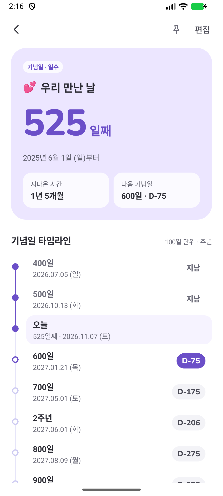
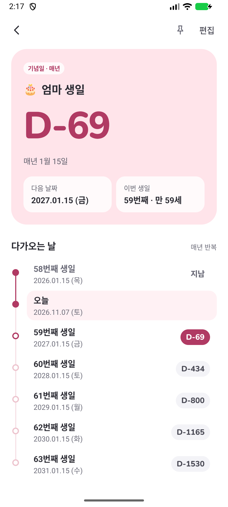
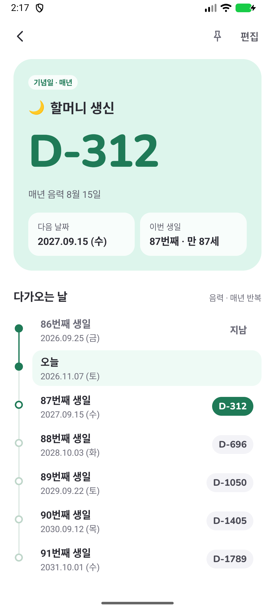
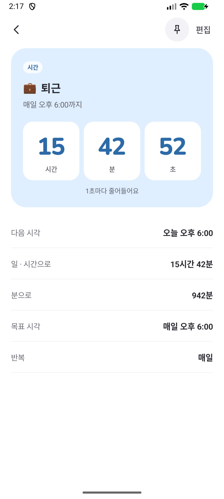
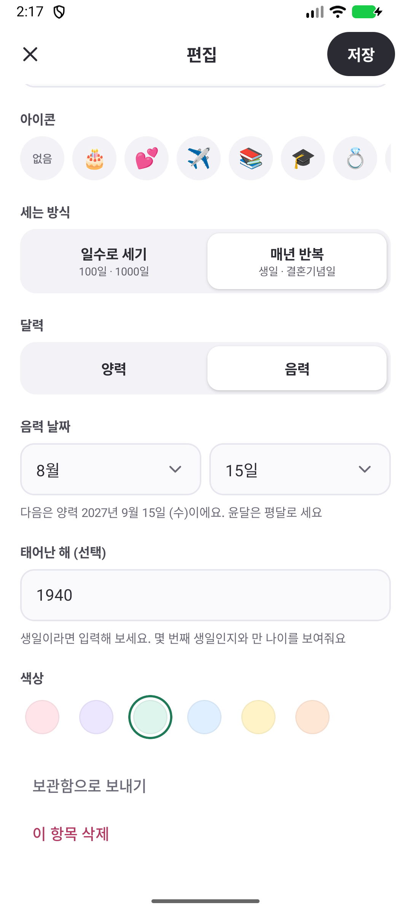
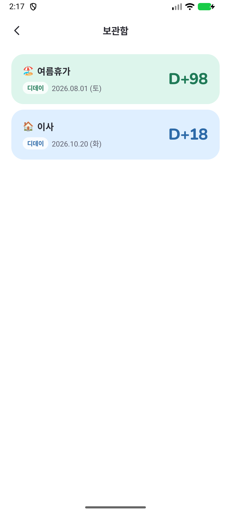
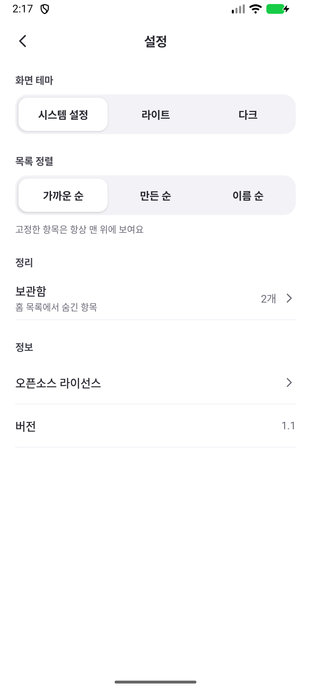
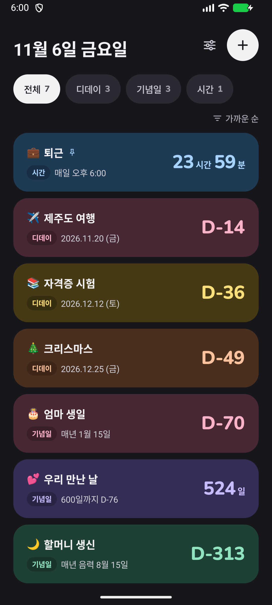
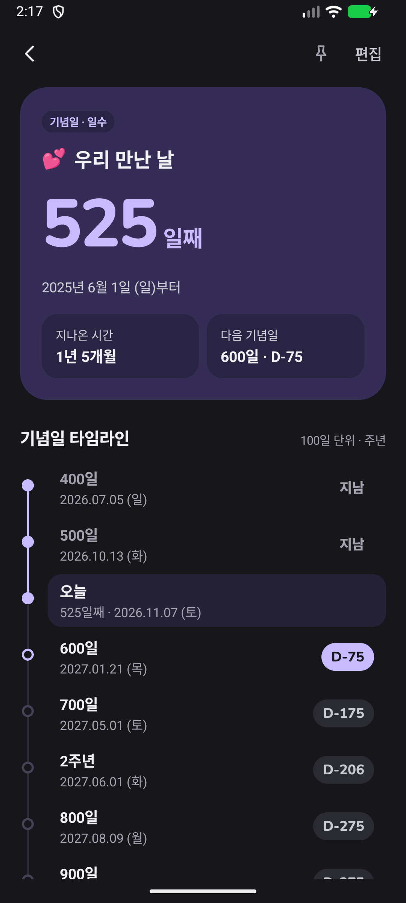

# 디데이

A simple, ad-free D-day, anniversary and countdown app for Android. Free and open source. The app itself is in Korean.

광고 없는 디데이·기념일·시간 카운트다운 안드로이드 앱입니다. 무료이고 소스가 공개돼 있습니다.

- 광고, 결제, 가입이 없습니다.
- 인터넷 권한이 없습니다. 데이터는 폰 안에만 저장되고 어디로도 보내지 않습니다.

| 홈 | 일수 기념일 | 생일 | 음력 기념일 | 시간 |
| --- | --- | --- | --- | --- |
|  |  |  |  |  |

| 편집 | 보관함 | 설정 | 홈(다크) | 상세(다크) |
| --- | --- | --- | --- | --- |
|  |  |  |  |  |

한글은 폰에 설정된 글꼴로 보입니다. 위 화면은 기본 글꼴입니다.

## 설치

[Releases](../../releases)에서 최신 `app-release.apk`를 내려받아 설치합니다. Android 8.0 이상에서 동작합니다.

스토어를 거치지 않는 설치라서, 처음 설치할 때 폰이 "출처를 알 수 없는 앱" 허용을 묻습니다.

## 기능

- **디데이**: 날짜까지 남은 날을 보여줍니다(`D-19`, 지난 날은 `D+3`).
- **기념일**
  - 일수로 세기: 시작일부터 며칠째인지 세고(`519일`), 100일 단위와 N주년을 타임라인으로 보여줍니다. 시작일을 1일로 셀지 고를 수 있습니다.
  - 매년 반복: 생일이나 결혼기념일처럼 매년 같은 날까지 남은 날을 셉니다. 음력 날짜도 쓸 수 있고(윤달은 평달로 셉니다), 태어난 해를 넣으면 "59번째 생일 · 만 59세"처럼 보여줍니다.
- **시간**: 정한 시각까지 남은 시간을 보여줍니다(`52시간 14분`). 상세 화면에서는 초 단위로 줄어듭니다. 퇴근 시간처럼 매일 반복할 수도 있습니다.
- **꾸미기**: 카드 색 6가지와 이름 앞에 붙는 아이콘(이모지)을 고릅니다.
- **목록 정리**: 카테고리별로 걸러 보고, 맨 위에 고정하고, 가까운 순·만든 순·이름 순으로 정렬합니다. 지난 디데이는 보관함으로 보내 숨길 수 있습니다.
- **화면 테마**: 시스템 설정·라이트·다크 중에서 고릅니다.

알림, 홈 화면 위젯, 파일 백업은 없습니다. 폰의 Google 백업이 켜져 있으면 데이터가 함께 백업됩니다.

## 후원

이 앱은 무료이고 광고가 없습니다. 도움이 됐다면 커피 한 잔 값으로 응원해 주세요.

- 카카오페이: <https://qr.kakaopay.com/Ej7szdxVo> (폰에서 누르면 카카오페이가 열립니다)
- 앱에서는 설정의 "응원하기"에서 보낼 수 있습니다.


## 직접 빌드하기

필요한 것은 Android Studio(내장 JDK 사용)와 Android SDK 37입니다.

```powershell
$env:JAVA_HOME = "C:\Program Files\Android\Android Studio\jbr"
.\gradlew.bat testDebugUnitTest assembleRelease
adb install -r app\build\outputs\apk\release\app-release.apk
```

- 릴리스 APK는 빌드하는 PC의 디버그 키로 서명됩니다. 서명이 다른 APK끼리는 덮어쓰기 설치가 안 되므로, Releases의 APK를 쓰다가 직접 빌드한 것으로 바꾸려면 앱을 지우고 다시 설치해야 합니다.
- 디버그 빌드는 패키지명이 `com.simple.dday.debug`이고 앱 이름에 β가 붙습니다. 그래서 릴리스 앱과 나란히 설치되고 데이터도 섞이지 않습니다.
- 음력 변환은 기기에 내장된 한국 음력 달력(ICU dangi)에 맡깁니다. 설날·추석 같은 실제 날짜와 맞는지는 기기나 에뮬레이터를 연결하고 `.\gradlew.bat connectedDebugAndroidTest`로 확인합니다.

## 구조

| 경로 | 내용 |
| --- | --- |
| `app/src/main/java/com/simple/dday/data` | 항목 모델(`Event`), 저장소(SharedPreferences에 JSON), 앱 설정 |
| `app/src/main/java/com/simple/dday/logic/Calc.kt` | 날짜·시간 계산, 정렬, 표시 형식 |
| `app/src/main/java/com/simple/dday/logic/Lunar.kt` | 음력을 양력으로 바꾸는 변환기 |
| `app/src/main/java/com/simple/dday/ui` | 홈, 새로 만들기/편집, 상세, 설정, 보관함 화면 (Jetpack Compose) |
| `app/src/main/java/com/simple/dday/ui/theme` | 라이트·다크 색 묶음 |
| `app/src/test` | 날짜 계산과 저장 형식 단위 테스트 |
| `app/src/androidTest` | 기기에서 돌리는 음력 변환 테스트 |
| `docs/design/mockup.html` | 첫 버전의 디자인 시안. 내려받아 브라우저로 열면 보입니다 |

버전: AGP 9.4.1, Kotlin 2.4.21(AGP 내장), Gradle 9.8.1, Compose BOM 2026.09.00, minSdk 26.

## 라이선스

[MIT](LICENSE)입니다. 단, 숫자 글꼴 Nunito(`app/src/main/res/font/nunito_extrabold.ttf`)는 SIL Open Font License 1.1을 따릅니다. 전문은 [licenses/Nunito-OFL.txt](licenses/Nunito-OFL.txt)에 있습니다.
