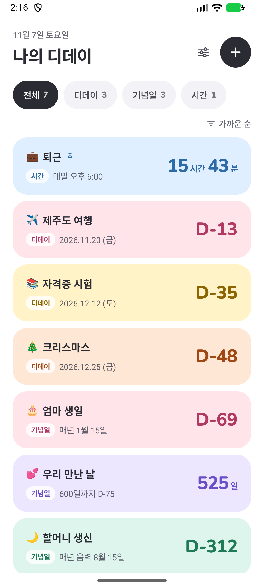
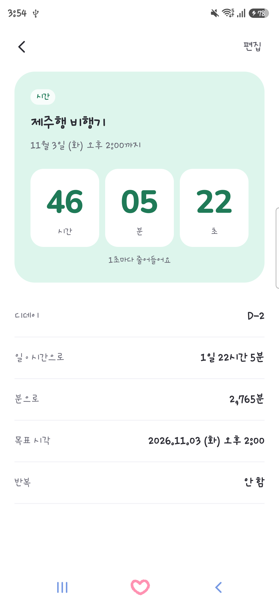
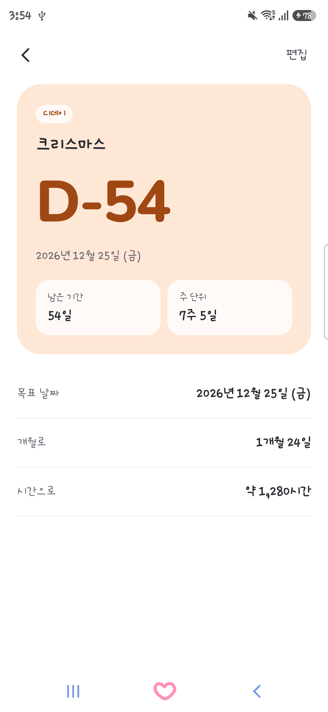
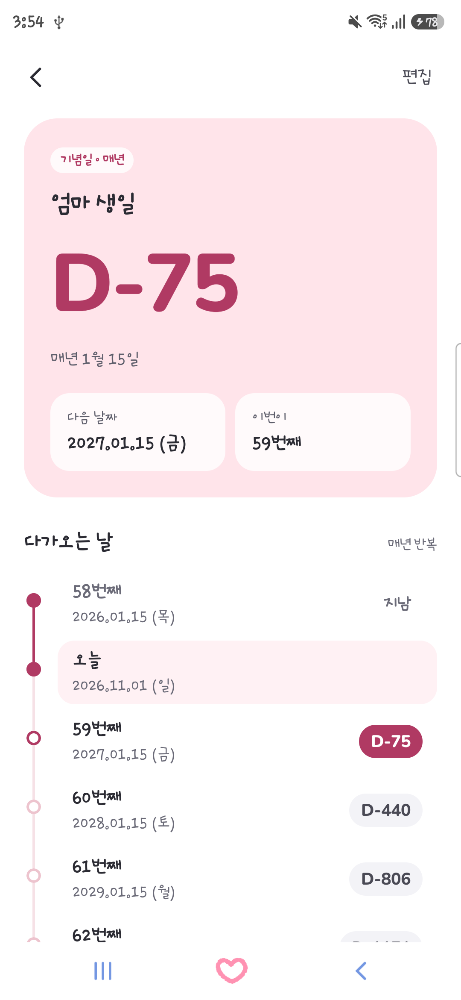
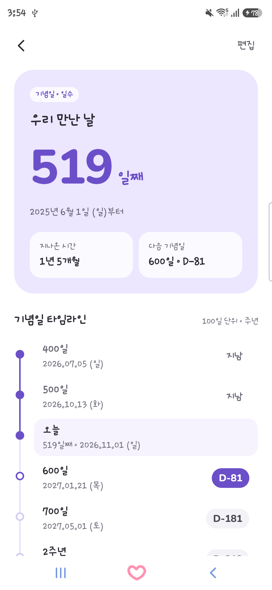
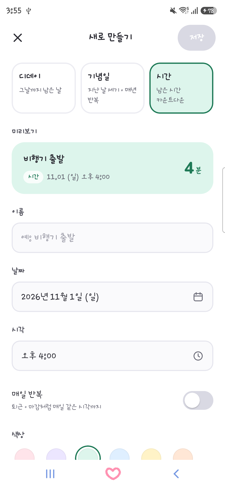
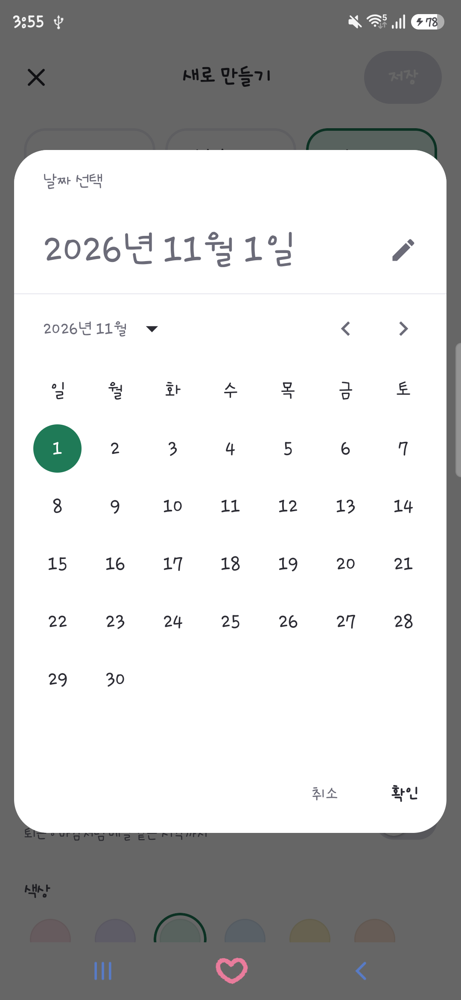

# 디데이

광고 없는 단순한 디데이·기념일·시간 카운트다운 안드로이드 앱.
데이터는 폰에만 저장하고 인터넷 권한이 없다.

## 기능

- **디데이**: 날짜까지 남은 날 (`D-19`, 지난 날은 `D+3`)
- **기념일**
  - 일수로 세기: 시작일부터 며칠째인지 (`519일`), 100일 단위·N주년 타임라인. 시작일을 1일로 셀지 고를 수 있다.
  - 매년 반복: 생일·결혼기념일처럼 매년 같은 날까지 남은 날
- **시간**: 특정 시각까지 남은 시간 (`52시간 14분`), 상세 화면은 초 단위로 줄어든다. 매일 반복(퇴근 시간 등) 가능.
- 카드 색 6가지(핑크·라벤더·민트·하늘·레몬·피치), 홈에서 카테고리별 필터

디자인 시안: https://claude.ai/artifact/7VefAz9UBS7bcWxhW6VamP

## 화면

Galaxy S25 Ultra에서 예시 데이터로 캡처했다. 한글은 폰에 설정된 시스템 글꼴을 따른다.

| 홈 | 시간 상세 | 디데이 상세 | 매년 반복 상세 |
| --- | --- | --- | --- |
|  |  |  |  |

| 일수 기념일 상세 | 새로 만들기 | 날짜 선택 |
| --- | --- | --- |
|  |  |  |

## 빌드와 설치

필요한 것: Android Studio(내장 JDK 사용), Android SDK 37

```powershell
$env:JAVA_HOME = "C:\Program Files\Android\Android Studio\jbr"
.\gradlew.bat testDebugUnitTest assembleRelease
adb install -r app\build\outputs\apk\release\app-release.apk
```

디버그 빌드는 패키지명이 `com.simple.dday.debug`라서 실제로 쓰는 앱과 따로 설치되고 데이터도 섞이지 않는다.

릴리스 APK는 이 PC의 디버그 키(`~/.android/debug.keystore`)로 서명한다.
같은 키로 빌드해야 기존 데이터를 유지한 채 덮어쓰기 설치가 된다.

## 구조

| 경로 | 내용 |
| --- | --- |
| `app/src/main/java/com/simple/dday/data` | 항목 모델(`Event`), SharedPreferences 저장소 |
| `app/src/main/java/com/simple/dday/logic/Calc.kt` | 날짜·시간 계산과 표시 형식 |
| `app/src/main/java/com/simple/dday/ui` | 홈, 새로 만들기/편집, 상세 화면 (Jetpack Compose) |
| `app/src/test` | 날짜 계산 단위 테스트 |

버전: AGP 9.4.1, Kotlin 2.4.21(AGP 내장), Gradle 9.8.1, Compose BOM 2026.09.00, minSdk 26.

숫자 글꼴 Nunito는 SIL Open Font License 1.1을 따른다. 전문은 [licenses/Nunito-OFL.txt](licenses/Nunito-OFL.txt).
